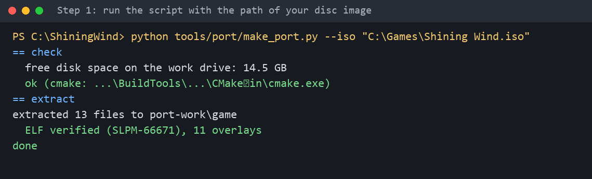
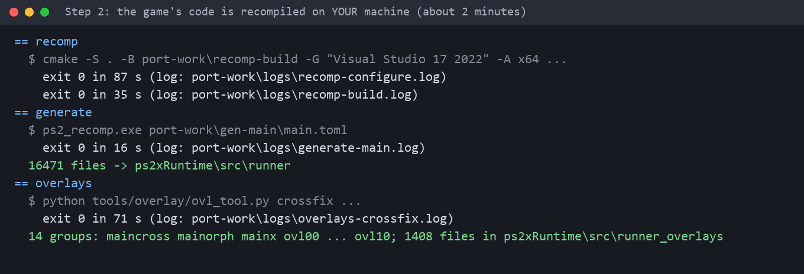
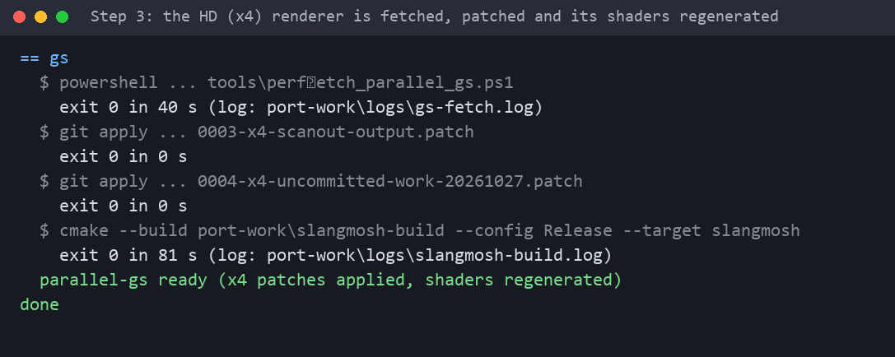
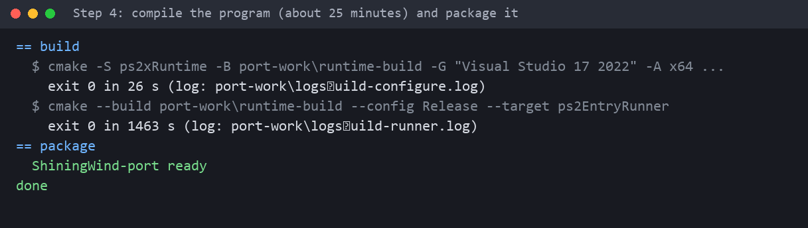
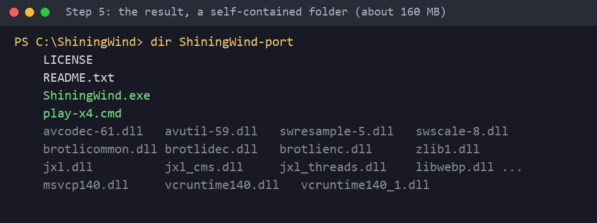

# Tutorial en español: generar el port desde tu ISO

[Volver al README](../README.md)

Todo el proceso es **un solo comando**. Tarda unos 40 minutos (casi todo compilando) y necesita unos 8 GB libres. Las imágenes son capturas de la salida real del script (rutas abreviadas); nunca muestran el juego.

## 0. Qué necesitás
* Windows 10 u 11 de 64 bits.
* **Visual Studio 2022** o **Build Tools for Visual Studio 2022** con la carga de trabajo **"Desarrollo para el escritorio con C++"** (trae compilador, Windows SDK y CMake): <https://visualstudio.microsoft.com/es/downloads/> (en "Herramientas para Visual Studio").
* **Git**: <https://git-scm.com/download/win>.
* **Python 3.9 o más nuevo**: <https://www.python.org/downloads/> (marcá "Add python.exe to PATH").
* Una GPU con driver **Vulkan** (cualquier driver reciente de NVIDIA / AMD / Intel).
* Unos **8 GB libres** para compilar y unos **4,5 GB** más para la copia del juego que guarda el programa en `%APPDATA%\ShiningWind`.
* Internet (se descargan paraLLEl-GS y algunas librerías).
* **Tu imagen de disco** `Shining Wind.iso`, volcado de tu propio disco NTSC-J **SLPM-66671**.

## 1. Conseguir la imagen del disco
Volcá tu propio disco a un archivo `.iso` con cualquier programa para copiar discos (imagen ISO9660 de unos 4,18 GB; se entienden `.iso` de 2048 bytes por sector y `.bin`/`.img` crudos de 2352). Guardala donde quieras, por ejemplo `C:\Games\Shining Wind.iso`. **El archivo no sale de tu PC y nunca se modifica.**

Solo funciona la edición NTSC-J **SLPM-66671**: el script comprueba el tamaño y el SHA-256 del ejecutable del juego antes de hacer nada y se detiene con un mensaje claro si es otra edición.

## 2. Descargar este repositorio
Abrí **PowerShell** y ejecutá:
```
cd C:\
git clone https://github.com/oxidonitroso88/shining_wind_public.git ShiningWind
cd ShiningWind
```

## 3. Ejecutar el script e indicar dónde está tu ISO
**Acá es donde se carga el `.iso`**: su ruta va después de `--iso` (con comillas si tiene espacios).
```
python tools/port/make_port.py --iso "C:\Games\Shining Wind.iso"
```


El script revisa tus herramientas y el disco y extrae solo lo necesario (el ejecutable y los overlays, 13 archivos chicos) en `port-work\game`. Si falta algo, escribe una línea `PROBLEM:` que dice qué instalar.

## 4. Esperar: lo construye todo solo
Cada etapa guarda su registro en `port-work\logs`.

**Recompilar el código del juego** (unos 2 minutos). Se generan unos 16 500 archivos en `ps2xRuntime\src\runner`; derivan del juego, git los ignora y **nunca hay que publicarlos**:



**El render HD** (unos 2 minutos): se descarga paraLLEl-GS en una versión fija, se aplican nuestros parches (reemplazo de texturas HD y salida ×4) y se regeneran sus shaders:



**Compilar** (unos 25 minutos, con 2 trabajos para que la PC siga usable). Es la parte larga. Los avisos `LNK4006` y `LNK4088` del final son normales:



## 5. El resultado
Cuando el script escribe `done`, el port queda en la carpeta `ShiningWind-port`:



Podés copiar esa carpeta a cualquier lado (unos 160 MB, no necesita instalar nada). No contiene datos del juego.

## 6. Primer arranque
Hacé doble clic en **`ShiningWind.exe`**. La primera vez pide el juego:
* elegí **imagen de disco** y seleccioná la misma `.iso` (o **carpeta extraída** si tenés los archivos del disco extraídos),
* verifica el disco y copia los archivos del juego a `%APPDATA%\ShiningWind\disc` (unos 4 GB, ~10 segundos en un SSD),
* recuerda tu elección: la próxima vez arranca directo.

Para guardar los datos en otra unidad, arrancalo desde un acceso directo o desde PowerShell con:
```
ShiningWind.exe --disc "C:\Games\Shining Wind.iso" --data-dir "D:\ShiningWindData"
```
Las partidas (memory card virtual) van a `<carpeta de datos>\memcards` y un registro corto de errores a `<carpeta de datos>\logs\ShiningWind.log`.

## 7. Jugar en HD (×4)
Usá **`play-x4.cmd`** en lugar de `ShiningWind.exe`: arranca el mismo programa con resolución interna ×4, que necesitan los paquetes de texturas HD.

**Controles** (teclado, si no hay mando conectado; con mando solo se usa el mando): **C** = ○, **X/Espacio** = ✕, **Z** = □, **V** = △, **Enter** = Start, **Tab** = Select, **Q/E** = L1/R1, **Shift izq./der.** = L2/R2, **flechas** = cruceta, **WASD** = stick izquierdo (caminar). No uses Esc como botón: cierra la ventana. **F10** activa/desactiva las texturas HD; **F7** abre el panel de extras.

## 8. Complementos opcionales (descarga aparte)
La traducción al inglés y los paquetes de texturas HD **no** están en este repositorio. Cuando los tengas, ponelos en la carpeta de datos (`%APPDATA%\ShiningWind` o la que indicaste con `--data-dir`):
```
%APPDATA%\ShiningWind\mods\        <- archivos de la traducción (ST\*.RAX y story_en.tsv)
%APPDATA%\ShiningWind\hd_packs\    <- una carpeta por paquete de texturas (cada una con su manifest.json)
```
Se cargan al arrancar el juego. Los paquetes HD necesitan `play-x4.cmd`.

Guía detallada (qué archivos son, subcarpetas, cómo comprobarlo y qué hacer si falla): [MODS.es.md](MODS.es.md) / [MODS.en.md](MODS.en.md).

## 9. Si algo falla
| Mensaje o síntoma | Qué hacer |
|---|---|
| `PROBLEM: Visual Studio 2022 ... not found` | instalá la carga de trabajo "Desarrollo para el escritorio con C++" (paso 0) y repetí el comando |
| `PROBLEM: less than 8 GB free` | liberá espacio o usá `--work D:\port-work` (otra unidad) |
| `unsupported edition` / `SHA-256 is ...` | tu disco no es el NTSC-J SLPM-66671, o la imagen está dañada o modificada |
| `not an ISO9660 image` | el archivo no es una imagen de disco simple (un `.cue` es solo texto: usá el `.bin`/`.iso` que lo acompaña) |
| Una etapa falla | se imprimen las últimas líneas de su registro; abrí `port-work\logs\<etapa>.log`. Podés repetir solo esa etapa: `python tools/port/make_port.py --iso "..." --stage build` (etapas: `check extract recomp generate overlays gs build package`) |
| La compilación parece colgada | compila unos 17 000 archivos con 2 trabajos; la etapa `build` tarda 25-30 minutos en una PC típica. Con 16 GB de RAM o más podés usar `--jobs 4` |
| Ventana negra o muy lento | actualizá el driver de la GPU (Vulkan). Sin Vulkan usa el render por CPU, que es lento |

Más detalle de cada etapa y de lo que se verificó: [BUILDING.md](BUILDING.md).
